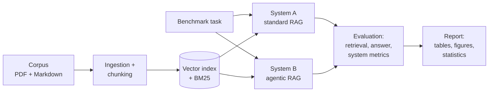

# Agentic-RAG-Bench

**Does an agentic retrieval pipeline outperform standard RAG on complex research tasks?**

A reproducible research benchmark comparing a standard (single-pass) RAG pipeline
with an agentic (iterative, self-correcting) retrieval pipeline on multi-step
research and synthesis tasks.

> **Status: harness complete, no real-model results yet.** Both systems, the
> 25-task benchmark, the evaluation framework, the experiment runner, and the
> statistical report all run end to end — entirely on free, deterministic mock
> providers. **No benchmark numbers with real models have been produced, and
> nothing in this repository should be quoted as a research result.** Sample
> runs are stamped "harness validation" in the generated report.

## 1. Motivation

Standard RAG retrieves once and answers once. That works for lookup questions,
but research-grade questions require decomposition, iterative evidence
gathering, contradiction handling, and careful citation. Agentic RAG promises
exactly that — at higher cost and latency. This project measures whether, and
where, that trade-off pays off.

## 2. Research question

> Does an agentic retrieval pipeline produce more accurate, complete,
> well-cited, and useful answers than standard RAG when tasks require
> multi-step research and synthesis?

Hypotheses under test (H1–H5) are documented in
[docs/methodology.md](docs/methodology.md). Results will not be forced to
support them.

## 3. Systems compared

| | System A — Standard RAG | System B — Agentic RAG |
|---|---|---|
| Retrieval | One pass (dense, optional BM25 hybrid, optional rerank) | Iterative, per-subquestion, with query rewriting |
| Planning | None | Query analysis + decomposition into subquestions |
| Evidence control | None | Sufficiency assessment, contradiction checking |
| Citations | Formatted verbatim from retrieved chunks | Same, **plus deterministic verification** before returning |
| Loop bounds | n/a | Hard caps on rounds, subquestions, tokens, cost, time + no-progress stop |

Fairness controls: both systems share the same corpus, chunking, embedder,
vector index, BM25, reranker, generation model, and seeds — enforced by a
shared `configs/default.yaml` and covered by a test.

## 4. Architecture



Details: [docs/architecture.md](docs/architecture.md).

## 5. Benchmark task levels

| Level | Category | Example task |
|---|---|---|
| 1 | Single-document factual | *What is the main contribution of RAPTOR?* |
| 2 | Multi-document comparison | *Compare GraphRAG and RAPTOR…* |
| 3 | Multi-hop synthesis | *Which retrieval approaches suit long-context LLMs, and why?* |
| 4 | Contradiction & evidence analysis | *Which papers disagree about reranking effectiveness?* |
| 5 | Research synthesis | *Write a structured literature review on adaptive retrieval…* |

25 tasks (5 per level) with reference answers and document-level gold evidence
live in [`data/benchmark/benchmark_v0.1.json`](data/benchmark/benchmark_v0.1.json),
authored against the sample corpus and regenerable via `make benchmark`.

## 6. Quick start

Requires Python 3.12 and [uv](https://docs.astral.sh/uv/). **No API keys and
no paid services** — everything below runs on deterministic mock providers.

```bash
git clone https://github.com/yasarkerem/mcp.git
cd mcp
make setup          # install dependencies + pre-commit hooks
make check          # lint + typecheck + 187 tests

# The full sample experiment, end to end:
make ingest         # sample corpus -> chunks + vector index + BM25
make experiment     # 4 systems x 25 tasks -> reports/results/*
make report         # tables + statistics + figures -> reports/report.md
```

With Docker: `make docker-build && docker run --rm agentic-rag-bench:dev info`.

To use a real model later: set `ANTHROPIC_API_KEY` in `.env` and switch
`generation.provider` to `anthropic` in a config — nothing calls a paid API
unless you do both explicitly.

## 7. Example query and output

From an actual sample run (agentic pipeline, **mock provider** — the answer is
an extractive template, not model prose; the citation contract is the point):

Question: *"What is the main contribution of RAPTOR?"* → stop reason
`evidence_sufficient` after 1 round; answer text cites chunk IDs inline; every
citation is verified against the store before being returned:

```json
{
  "document_id": "raptor_overview",
  "title": "RAPTOR: Recursive Abstractive Processing for Tree-Organized Retrieval",
  "page": null,
  "chunk_id": "raptor_overview_p0_c0",
  "quoted_evidence": "RAPTOR's main contribution is a hierarchical retrieval index built by recursively clustering text chunks...",
  "retrieval_score": 0.29
}
```

## 8. Evaluation metrics

- **Retrieval:** Recall@k, Precision@k, MRR, nDCG, source coverage, unique relevant documents.
- **Answer:** factual correctness, completeness, citation correctness/completeness, groundedness, hallucination rate, contradiction handling, structure.
- **System:** latency, retrieval rounds, LLM calls, tokens, estimated cost, failure rate.

Evaluation layers deterministic checks (exact citation verification, gold-label
retrieval metrics, lexical proxies with documented limitations) with a
versioned LLM-as-judge abstraction — the judge is never the only evaluator.

## 9. Reproduction

Every experiment directory contains `metadata.json` (fully-resolved config,
git commit, timestamp, benchmark version, model names, prompt versions, seed)
and `results.jsonl` (per-task answers, retrieved chunks, agent traces, scores,
latency, cost). `make evaluate` re-scores stored runs after evaluator changes.
The report includes mean/median/sd, seeded bootstrap CIs, and paired Wilcoxon
signed-rank tests; small samples are flagged and no significance is claimed
without a test. See [docs/experiment_design.md](docs/experiment_design.md).

## 10. Current limitations

- **No real-model results.** The default stack is deliberately free: hash-based
  embeddings, lexical reranker, mock LLM. It validates the harness, not the
  hypotheses. Real experiments require plugging in real providers.
- The sample corpus is 11 original summary documents written for this project —
  not actual papers. Real corpora go into `data/raw/` (PDF/Markdown supported).
- Deterministic answer metrics are lexical proxies (documented per metric).
- The vector index is in-memory (exact cosine) — fine for small corpora; a
  Qdrant adapter is future work (compose service already provisioned).
- Gold evidence is document-level; chunk-level labels are future work.

## 11. Roadmap

1. ✅ Phases 1–8 — full harness: ingestion, retrieval, both pipelines,
   benchmark, evaluation, experiment runner, statistics, reporting, docs
2. Real-model experiments (API embeddings + generation + LLM judge)
3. Real paper corpus (open-access PDFs) + benchmark v0.2 with chunk-level gold
4. Qdrant adapter, cross-encoder reranker variant
5. Human evaluation pass and publication-ready analysis

## 12. Citing this repository

```bibtex
@software{agentic_rag_bench,
  author = {Yasar, Kerem},
  title  = {Agentic-RAG-Bench: Benchmarking Agentic vs. Standard RAG on Complex Research Tasks},
  url    = {https://github.com/yasarkerem/mcp},
  year   = {2026}
}
```
