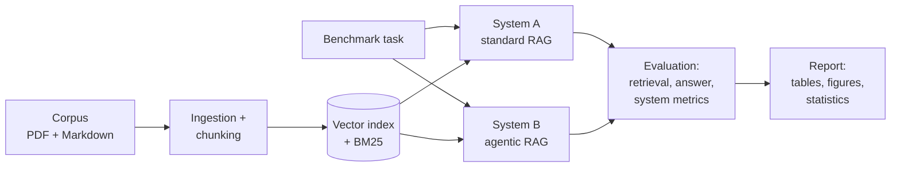

# Agentic-RAG-Bench

**Does an agentic retrieval pipeline outperform standard RAG on complex research tasks?**

A reproducible research benchmark comparing a standard (single-pass) RAG pipeline
with an agentic (iterative, self-correcting) retrieval pipeline on multi-step
research and synthesis tasks over a corpus of AI/RAG research papers.

> **Status: Phase 1 — repository foundation.** The project scaffold, typed
> configuration, core schemas, logging, tooling, and CI exist. The retrieval
> pipelines, benchmark tasks, and evaluation framework arrive in later phases
> (see [WORKLOG.md](WORKLOG.md)). **There are no benchmark results yet.**

## 1. Motivation

Standard RAG retrieves once and answers once. That works for lookup questions,
but research-grade questions require decomposition, iterative evidence
gathering, contradiction handling, and careful citation. Agentic RAG promises
exactly that — at higher cost and latency. This project measures whether, and
where, that trade-off pays off.

## 2. Research question

> Does an agentic retrieval pipeline produce more accurate, complete,
> well-cited, and useful answers than standard RAG when tasks require
> multi-step research and synthesis?

Hypotheses under test (H1–H5) are documented in
[docs/methodology.md](docs/methodology.md). Results will not be forced to
support them.

## 3. Systems compared

| | System A — Standard RAG | System B — Agentic RAG |
|---|---|---|
| Retrieval | One pass (dense, optional BM25 hybrid, optional rerank) | Iterative, per-subquestion, with query rewriting |
| Planning | None | Query analysis + research plan + decomposition |
| Evidence control | None | Sufficiency assessment, contradiction checking |
| Citations | Formatted from retrieved chunks | Formatted from retrieved chunks **and verified** |
| Loop bounds | n/a | Hard caps on rounds, subquestions, tokens, cost, time |

Fairness controls: both systems share the same corpus, embedding model, vector
store, reranker, generation model, and comparable budgets.

## 4. Architecture



Details: [docs/architecture.md](docs/architecture.md).

## 5. Benchmark task levels

| Level | Category | Example |
|---|---|---|
| 1 | Single-document factual | *What is the main contribution of RAPTOR?* |
| 2 | Multi-document comparison | *Compare GraphRAG and RAPTOR…* |
| 3 | Multi-hop synthesis | *Which retrieval approaches suit long-context LLMs, and why?* |
| 4 | Contradiction & evidence analysis | *Which papers disagree about reranking effectiveness?* |
| 5 | Research synthesis | *Write a structured literature review on adaptive retrieval…* |

≥ 5 tasks per level, ≥ 25 total, stored machine-readably in `data/benchmark/`
(arrives in Phase 5).

## 6. Quick start

Requires Python 3.12 and [uv](https://docs.astral.sh/uv/).

```bash
git clone https://github.com/yasarkerem/mcp.git
cd mcp
make setup          # install dependencies + pre-commit hooks
make check          # lint + typecheck + tests (no API keys needed)

# CLI
uv run arb info
uv run arb validate-config configs/agentic_rag.yaml
```

With Docker:

```bash
make docker-build
docker run --rm agentic-rag-bench:dev info
```

Later phases: `make ingest`, `make benchmark`, `make experiment`,
`make evaluate`, `make report` (currently exit with a clear
"not implemented until Phase N" message).

## 7. Example query and output

*Placeholder — will be filled with a real, reproduced example once the
pipelines exist (Phase 3+).* The output contract is already fixed: every
answer returns structured citations grounded in retrieved chunks:

```json
{
  "document_id": "paper_001",
  "title": "Example Paper",
  "page": 4,
  "chunk_id": "paper_001_p4_c2",
  "quoted_evidence": "Relevant supporting passage",
  "retrieval_score": 0.84
}
```

## 8. Evaluation metrics

- **Retrieval:** Recall@k, Precision@k, MRR, nDCG, source coverage, unique relevant documents.
- **Answer:** factual correctness, completeness, citation correctness/completeness, groundedness, hallucination rate, contradiction handling, structure.
- **System:** latency, retrieval rounds, LLM calls, tokens, estimated cost, failure rate.

Evaluation combines deterministic checks, gold labels, and versioned
LLM-as-judge prompts — the judge is never the only evaluator.

## 9. Reproduction

Every experiment records its configuration, git commit, timestamp, benchmark
version, model names, prompts, outputs, retrieved chunks, traces, scores,
latency, and cost (JSONL). Tests run entirely on mock providers — no API keys
required. See [docs/experiment_design.md](docs/experiment_design.md).

## 10. Current limitations

- **No pipelines, benchmark tasks, or results yet** — Phase 1 is foundation only.
- Corpus tooling, retrieval, and evaluation land in Phases 2–5.
- The initial corpus is small and limited to AI/RAG literature.

## 11. Roadmap

1. ✅ Phase 1 — repository foundation
2. Phase 2 — ingestion, chunking, dense/BM25/hybrid retrieval, reranking
3. Phase 3 — standard RAG baseline
4. Phase 4 — agentic RAG state machine
5. Phase 5 — benchmark tasks + evaluation framework
6. Phase 6 — experiment runner
7. Phase 7 — reporting + statistics
8. Phase 8 — documentation + release

## 12. Citing this repository

```bibtex
@software{agentic_rag_bench,
  author = {Yasar, Kerem},
  title  = {Agentic-RAG-Bench: Benchmarking Agentic vs. Standard RAG on Complex Research Tasks},
  url    = {https://github.com/yasarkerem/mcp},
  year   = {2026}
}
```
